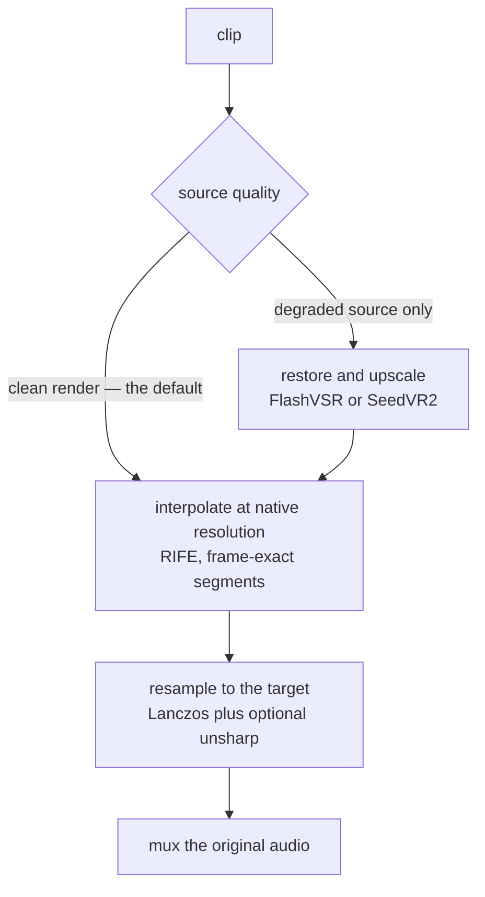

# mmd-upscale-pipeline

**English** · [中文](README.zh-CN.md)

An agent skill that resamples and frame-interpolates **MMD and other anime/CG
video** on a local workstation — no cloud service, no per-use cost.

It exists because the obvious approach is wrong. Feeding a clean render to an AI
restoration model makes it *softer*, not sharper: measured on a real 1080p MMD
render, a FlashVSR pass came back with 18% less high-frequency detail than a plain
Lanczos scale-up, cost ten times as long, and also flattened highlights, added
temporal flicker and shifted content by ~0.15 s. So this skill defaults to the
path that actually wins on clean material, and keeps the AI path for the material
it genuinely helps.

## What it does

| Job | Default path | When to use the alternative |
|---|---|---|
| **Raise resolution** (1080p → 1440p/4K) | Lanczos resample + optional unsharp, in one ffmpeg pass | `-Restore flashvsr` / `seedvr2` only for *degraded* sources: compressed web rips, soft or low-bitrate footage |
| **Raise frame rate** (30 → 60fps) | RIFE interpolation, in frame-exact segments | — |
| **Both at once** | Restore stage (if any) first, then interpolate, then resample | — |



It drives a local **ComfyUI** install for the model stages and **ffmpeg** for
assembly, discovers both instead of assuming where they live, and reports what a
machine can actually do before starting a long job.

If you render your own MMD material, the honest advice is in the skill: rendering
at the target resolution and frame rate beats anything this pipeline can do, because
upscaling and interpolation both invent information. This skill is for masters whose
project is gone.

## Requirements

### Host

| | |
|---|---|
| OS | **Windows** — the drivers are PowerShell. Only `scripts/qc_interp.py` is cross-platform. Untested on macOS/Linux. |
| Shell | PowerShell 5.1 or PowerShell 7+ |
| ffmpeg | `ffmpeg` **and** `ffprobe` on `PATH`. Everything downstream of the model stages is ffmpeg. |
| GPU | An NVIDIA GPU for the interpolation and AI-restore stages. VRAM decides segment sizes and how far upscaling can go. |

Resample-only jobs (`-Mode upscale -Restore none`) need nothing but ffmpeg.

### ComfyUI

Any install works — the portable build (`<root>\ComfyUI\main.py` + `python_embeded`)
or a source install (`<root>\main.py` + `.venv`). It is found by probing
`COMFYUI_PATH`, the common portable locations, and any `ComfyUI*` folder under a
drive root. Needed for frame interpolation and for AI restore; never edited by this
skill.

### Custom nodes

| Pack | Needed for | Required? |
|---|---|---|
| [ComfyUI-VideoHelperSuite](https://github.com/Kosinkadink/ComfyUI-VideoHelperSuite) | reading and writing frames (`VHS_LoadVideo`, `VHS_VideoCombine`) | **Yes** — the pipeline cannot run without it |
| [ComfyUI-FlashVSR](https://github.com/1038lab/ComfyUI-FlashVSR) | `-Restore flashvsr` | Only for that mode |
| [ComfyUI-SeedVR2_VideoUpscaler](https://github.com/numz/ComfyUI-SeedVR2_VideoUpscaler) | `-Restore seedvr2` | Only for that mode |
| [ComfyUI-Frame-Interpolation](https://github.com/Fannovel16/ComfyUI-Frame-Interpolation) | extra VFI methods | No — interpolation uses ComfyUI's built-in `FrameInterpolate` node |

> Known issue: the Frame-Interpolation pack's bundled `ckpts/rife426.pth` is a
> training checkpoint (its `state_dict` keys carry a `teacher.` prefix) and fails to
> load. The built-in node is what this skill uses.

### Models

| Stage | Files | Size | Source |
|---|---|---|---|
| Interpolation | `models/frame_interpolation/rife_v4.26.safetensors` (or `_heavy`) | 22 MB | [Comfy-Org/frame_interpolation](https://huggingface.co/Comfy-Org/frame_interpolation) → `frame_interpolation/` |
| Interpolation, large motion | `models/frame_interpolation/film_net_fp16.safetensors` | 66 MB | same repo. Note: FILM builds multi-scale pyramids and ran out of memory on a 12GB card at 4K with only 12 frames, so it needs much smaller segments there |
| AI restore — FlashVSR | `models/FlashVSR/` (5 files) | 6.2 GB | [1038lab/FlashVSR](https://huggingface.co/1038lab/FlashVSR) |
| AI restore — SeedVR2 | `models/SEEDVR2/` (3B fp8 + VAE) | 3.7 GB | [numz/SeedVR2_comfyUI](https://huggingface.co/numz/SeedVR2_comfyUI) |

The node packs download their weights on first use. Behind a restricted network,
point the launcher at a mirror: `.\scripts\launch-comfyui.ps1 -HfEndpoint
https://hf-mirror.com`.

### Companion skills

**None are required — this skill is self-contained.** These are related, and useful
only in the cases noted:

| Skill | Why you might want it |
|---|---|
| `video-upscale` ([artokun/comfyui-mcp](https://github.com/artokun/comfyui-mcp)) | The general ComfyUI video-upscaling methodology this skill was distilled from. Adds background on models and VRAM tiers when working outside MMD. |
| `comfyui-mcp` (same repo) | An MCP server that lets an agent drive ComfyUI directly. Optional — this skill's scripts talk to ComfyUI's HTTP API themselves. |
| `skill-creator` | Only if you want to modify this skill. |

```
npx skills add artokun/comfyui-mcp@video-upscale
```

## Install

```
npx skills add FumizukiDoroneko/mmd-upscale-pipeline
```

## Quick start

Probe the machine first — read-only, and it reports which jobs are possible:

```powershell
.\scripts\probe-env.ps1
```

Then:

```powershell
# 1440p60 from a clean 1080p render: no AI, sharpened. Minutes, not hours.
.\scripts\mmd_upscale_batch.ps1 -InputDir 'D:\renders' -OutputDir 'D:\out' -TargetShortEdge 1440

# interpolation only, resolution untouched
.\scripts\mmd_upscale_batch.ps1 -InputDir 'D:\renders' -Mode interp

# AI restore — degraded sources only
.\scripts\mmd_upscale_batch.ps1 -InputDir 'D:\web rips' -Restore flashvsr -TargetShortEdge 1440
```

Input/output folders, the ComfyUI interpreter and the interpolation segment size
are all derived from what the machine reports; nothing needs editing first.

## Contents

| File | Role |
|---|---|
| `SKILL.md` | What the agent reads: path selection, constraints, verification procedure |
| `references/measurements.md` | Measured throughput, model comparisons, and the failure history |
| `scripts/probe-env.ps1` | Environment report and which jobs are viable |
| `scripts/comfy-env.ps1` | Discovery helpers (dot-sourced, never run directly) |
| `scripts/launch-comfyui.ps1` | Start ComfyUI with the environment the node packs need |
| `scripts/mmd_upscale_batch.ps1` | The batch driver |
| `scripts/qc_interp.py` | Interpolation quality check — how much softer the invented frames are |

## Not for

Generating video, editorial cuts, subtitling, or cloud/AI video services.

## License

MIT — see [LICENSE](LICENSE).
