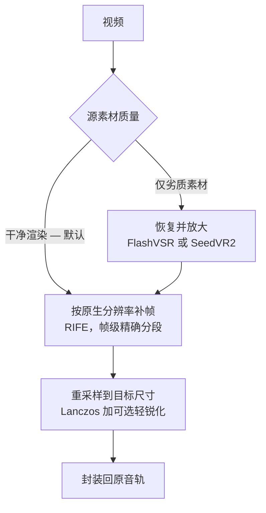

# mmd-upscale-pipeline

[English](README.md) · **中文**

一个 agent 技能，用于在本机对 **MMD 及动画 / CG 视频**做分辨率提升与补帧——不依赖任何云服务，也没有按次费用。

它存在的理由是一个反直觉的实测结论：把干净的渲染素材喂给 AI 恢复模型，结果会变**软**而不是变锐。在真实的 1080p MMD 渲染上实测，FlashVSR 出来的高频细节比直接用 Lanczos 放大的结果**少 18%**，耗时却是十倍，同时还会压平高光、引入时序闪烁，并把画面内容整体前移约 0.15 秒。所以本技能默认走真正有效的那条路，把 AI 留给它确实能帮上忙的素材。

## 它能做什么

| 任务 | 默认走法 | 什么时候才该用备选方案 |
|---|---|---|
| **提升分辨率**（1080p → 1440p / 4K） | Lanczos 重采样 + 可选轻锐化，一次 ffmpeg 完成 | `-Restore flashvsr` / `seedvr2` 只用于**劣质素材**：网络二压过的、发糊的、低码率的片子 |
| **提升帧率**（30 → 60fps） | RIFE 补帧，按帧精确分段 | — |
| **两者同时做** | 先做恢复阶段（如果有），再补帧，最后重采样 | — |



模型阶段跑在本地 **ComfyUI** 上，拼装环节用 **ffmpeg**。两者都是自动探测而非写死路径，并且在开长任务前先报告这台机器到底能做哪些事。

如果你是自己渲染 MMD 素材的，技能里给的诚实建议是：**直接按目标分辨率和帧率渲染，效果超过这条流水线能做的任何事**——因为超分和补帧本质上都是在猜信息。这个技能是给工程文件已经丢失的成片兜底的。

## 前置条件

### 运行环境

| | |
|---|---|
| 操作系统 | **Windows**——驱动脚本是 PowerShell。只有 `scripts/qc_interp.py` 是跨平台的。macOS / Linux 未经验证。 |
| Shell | PowerShell 5.1 或 PowerShell 7+ |
| ffmpeg | `ffmpeg` **和** `ffprobe` 都要在 `PATH` 上。模型阶段之后的所有环节都依赖 ffmpeg。 |
| 显卡 | 补帧和 AI 恢复需要 NVIDIA 显卡。显存大小决定分段尺寸以及分辨率能提到多高。 |

只做重采样（`-Mode upscale -Restore none`）的话，除 ffmpeg 外什么都不需要。

### ComfyUI

便携版和源码版都支持——便携版是 `<root>\ComfyUI\main.py` 加 `python_embeded`，源码版是 `<root>\main.py` 加 `.venv`。探测顺序是 `COMFYUI_PATH`、常见便携版位置、以及各磁盘根目录下叫 `ComfyUI*` 的文件夹。补帧和 AI 恢复需要它；本技能不会修改它的任何文件。

### 自定义节点

| 节点包 | 用途 | 是否必需 |
|---|---|---|
| [ComfyUI-VideoHelperSuite](https://github.com/Kosinkadink/ComfyUI-VideoHelperSuite) | 读写视频帧（`VHS_LoadVideo`、`VHS_VideoCombine`） | **必需**——缺了整条流水线跑不起来 |
| [ComfyUI-FlashVSR](https://github.com/1038lab/ComfyUI-FlashVSR) | `-Restore flashvsr` | 只在该模式下需要 |
| [ComfyUI-SeedVR2_VideoUpscaler](https://github.com/numz/ComfyUI-SeedVR2_VideoUpscaler) | `-Restore seedvr2` | 只在该模式下需要 |
| [ComfyUI-Frame-Interpolation](https://github.com/Fannovel16/ComfyUI-Frame-Interpolation) | 额外的补帧算法 | 不需要——补帧用的是 ComfyUI 内置的 `FrameInterpolate` 节点 |

> 已知问题：Frame-Interpolation 包里自带的 `ckpts/rife426.pth` 是训练用检查点（`state_dict` 的键带 `teacher.` 前缀），加载会直接失败。本技能用的是内置节点。

### 模型

| 阶段 | 文件 | 体积 | 来源 |
|---|---|---|---|
| 补帧 | `models/frame_interpolation/rife_v4.26.safetensors`（或 `_heavy`） | 22 MB | [Comfy-Org/frame_interpolation](https://huggingface.co/Comfy-Org/frame_interpolation) 下的 `frame_interpolation/` |
| 补帧（大幅运动） | `models/frame_interpolation/film_net_fp16.safetensors` | 66 MB | 同上。注意：FILM 内部会建多尺度金字塔，在 12GB 显卡上 4K 只跑 12 帧就爆显存，因此需要把分段压得很小 |
| AI 恢复 — FlashVSR | `models/FlashVSR/`（5 个文件） | 6.2 GB | [1038lab/FlashVSR](https://huggingface.co/1038lab/FlashVSR) |
| AI 恢复 — SeedVR2 | `models/SEEDVR2/`（3B fp8 + VAE） | 3.7 GB | [numz/SeedVR2_comfyUI](https://huggingface.co/numz/SeedVR2_comfyUI) |

节点包会在首次使用时自动下载权重。如果网络受限，让启动器走镜像即可：`.\scripts\launch-comfyui.ps1 -HfEndpoint https://hf-mirror.com`。

### 相关技能

**都不需要——本技能是自包含的。** 下面这些只是相关，仅在对应情况下有用：

| 技能 | 什么情况下有用 |
|---|---|
| `video-upscale`（[artokun/comfyui-mcp](https://github.com/artokun/comfyui-mcp)） | 本技能蒸馏自的通用 ComfyUI 视频超分方法论。处理非 MMD 素材时能补充模型选择与显存分档的背景。 |
| `comfyui-mcp`（同一仓库） | 让 agent 直接驱动 ComfyUI 的 MCP 服务器。可选——本技能的脚本自己调用 ComfyUI 的 HTTP 接口。 |
| `skill-creator` | 只有你想修改这个技能本身才需要。 |

```
npx skills add artokun/comfyui-mcp@video-upscale
```

## 安装

```
npx skills add FumizukiDoroneko/mmd-upscale-pipeline
```

## 快速开始

先探测这台机器（只读，不会改动任何东西），它会告诉你哪些任务可行：

```powershell
.\scripts\probe-env.ps1
```

然后：

```powershell
# 干净 1080p 渲染 → 1440p60：不用 AI，带锐化。几分钟，不是几小时
.\scripts\mmd_upscale_batch.ps1 -InputDir 'D:\renders' -OutputDir 'D:\out' -TargetShortEdge 1440

# 只补帧，分辨率不动
.\scripts\mmd_upscale_batch.ps1 -InputDir 'D:\renders' -Mode interp

# AI 恢复——只用于劣质素材
.\scripts\mmd_upscale_batch.ps1 -InputDir 'D:\web rips' -Restore flashvsr -TargetShortEdge 1440
```

输入输出目录、ComfyUI 解释器位置、补帧分段大小全部来自机器实际探测结果，不需要先改任何配置。

## 文件说明

| 文件 | 作用 |
|---|---|
| `SKILL.md` | agent 读取的入口：路径选择、硬性约束、验收流程 |
| `references/measurements.md` | 实测数据、模型对比、以及踩过的坑 |
| `scripts/probe-env.ps1` | 环境报告与可行任务清单 |
| `scripts/comfy-env.ps1` | 探测工具函数（被引用，不直接运行） |
| `scripts/launch-comfyui.ps1` | 用节点包所需的环境变量启动 ComfyUI |
| `scripts/mmd_upscale_batch.ps1` | 批量处理驱动脚本 |
| `scripts/qc_interp.py` | 补帧质检——量化插值帧比原始帧软多少 |

## 不适用

视频生成、剪辑、字幕，以及云端 / AI 视频服务。

## 许可证

MIT——见 [LICENSE](LICENSE)。
